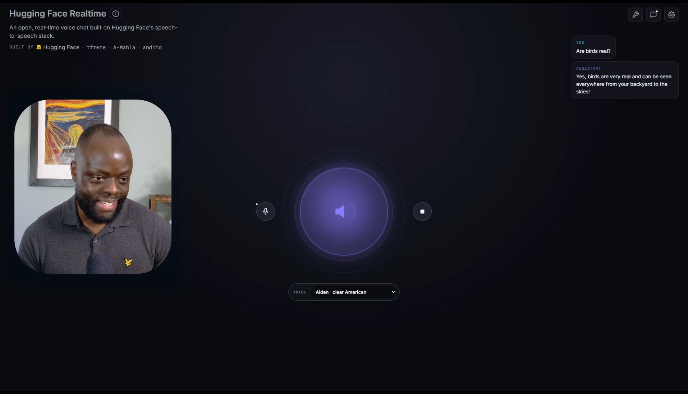
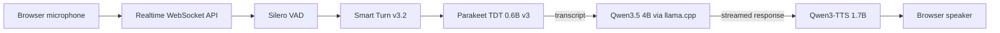

<div align="center">

# Local Speech-to-Speech Voice Agent

### A fully local, modular voice assistant built with open-source models

[](https://www.python.org/)
[](./src/speech_to_speech/api/openai_realtime/README.md)
[](./LICENSE)

</div>

Fully local voice chat: microphone audio goes in, a local model thinks, and generated speech comes back through an OpenAI Realtime-compatible API.

Built on [Hugging Face's `speech-to-speech`](https://github.com/huggingface/speech-to-speech) and customized as a fully local voice-agent stack.

## Demo

### Video walkthrough

I built, tested, and explained the full stack on my YouTube channel.

<p align="center">
  <a href="https://youtu.be/uYQzl-4HGzo">
    
  </a>
</p>

**[Watch the full video here](https://youtu.be/uYQzl-4HGzo)**

### Screenshot

<p align="center">
  
</p>

The browser interface during a live local conversation.

## What I changed

- Wired Qwen3.5 GGUF into the pipeline through a local `llama.cpp` server.
- Configured Parakeet TDT for live transcription and Qwen3-TTS GGUF for local speech output.
- Added Smart Turn v3.2 semantic endpointing for more natural pauses and interruptions.
- Added one command to start, stop, and monitor the LLM, speech pipeline, and browser demo.
- Added a visible voice picker with nine Qwen3-TTS CustomVoice speakers.
- Kept model paths, ports, devices, and voices configurable through an ignored `.env` file.

## How it works



Each stage runs independently and communicates through queues, so the backends can be swapped without rewriting the rest of the application. The Realtime layer also handles live transcripts, streaming audio, and user interruptions.

## The local stack

| Stage | Model / runtime | Role |
|---|---|---|
| VAD | [Silero VAD v5](https://github.com/snakers4/silero-vad) | Detects speech boundaries from microphone audio. |
| Turn detection | [Smart Turn v3.2 CPU ONNX](https://huggingface.co/pipecat-ai/smart-turn-v3) | Distinguishes a completed turn from a mid-sentence pause. |
| STT | [NVIDIA Parakeet TDT 0.6B v3](https://huggingface.co/nvidia/parakeet-tdt-0.6b-v3) | Multilingual streaming speech recognition. |
| LLM | [Qwen3.5 4B UD-Q4_K_XL GGUF](https://huggingface.co/unsloth/Qwen3.5-4B-GGUF) | Generates the assistant response locally through `llama.cpp`. |
| TTS | [Qwen3-TTS 12Hz 1.7B CustomVoice](https://huggingface.co/Qwen/Qwen3-TTS-12Hz-1.7B-CustomVoice) | Synthesizes the response with selectable built-in voices. |
| API | Hugging Face speech-to-speech + FastAPI | Exposes WebSocket and WebRTC transports compatible with OpenAI Realtime clients. |

The launcher uses Q4-class quantization for the LLM and Q8 GGUF files for the TTS talker and codec. Model weights are downloaded separately and stay out of Git.

## How it's put together

```text
speech-to-speech/
├── demo/                       # Browser voice-chat interface
├── models/                     # Local weights (ignored by Git)
│   ├── llm/
│   ├── qwen3-tts/
│   └── smart-turn-v3/
├── scripts/
│   └── local_stack.sh          # Starts, stops, and monitors all services
├── src/speech_to_speech/
│   ├── VAD/                    # Silero VAD and Smart Turn
│   ├── STT/                    # Parakeet and alternative STT backends
│   ├── LLM/                    # Local and hosted LLM integrations
│   ├── TTS/                    # Qwen3-TTS and alternative voices
│   └── api/openai_realtime/    # Realtime WebSocket/WebRTC server
├── tests/
├── .env.example                # Portable local model configuration
└── README.md
```

## Setup

The launcher targets Linux or WSL2 with an NVIDIA GPU. Python 3.10+, [`uv`](https://docs.astral.sh/uv/), `curl`, and a CUDA-enabled [`llama.cpp`](https://github.com/ggml-org/llama.cpp) build that provides `llama-server` are required.

Tested on Ubuntu under WSL2 with an RTX 5060 Ti, Python 3.11, and `llama.cpp`.

### 1. Clone and install

```bash
git clone https://github.com/gkintu/hf-speech-to-speech.git
cd hf-speech-to-speech

uv sync
```

### 2. Download the model files

Install the Hugging Face CLI if it is not already available:

```bash
uv tool install "huggingface_hub[cli]"
mkdir -p models/llm models/qwen3-tts models/smart-turn-v3
```

Download the local LLM, TTS, and turn-detection weights:

```bash
hf download unsloth/Qwen3.5-4B-GGUF \
  Qwen3.5-4B-UD-Q4_K_XL.gguf \
  --local-dir models/llm

hf download FindaDeath/Qwen3-TTS-GGUF \
  qwen-talker-1.7b-customvoice-Q8_0.gguf \
  qwen-tokenizer-12hz-Q8_0.gguf \
  --local-dir models/qwen3-tts

hf download pipecat-ai/smart-turn-v3 \
  smart-turn-v3.2-cpu.onnx \
  --local-dir models/smart-turn-v3
```

Parakeet TDT is downloaded automatically from the Hugging Face Hub on first use.

Review and accept each model provider's license before downloading or using its files.

### 3. Configure local paths

The default paths already match the layout above. To keep the weights somewhere else, copy the example and edit only the required values:

```bash
cp .env.example .env
```

`.env` is ignored by Git. It can also be used to change ports, devices, and the selected speaker without modifying the launcher.

## Run it

Start the LLM server, speech pipeline, and browser demo together:

```bash
./scripts/local_stack.sh run
```

Open **[http://localhost:7860](http://localhost:7860)**, allow microphone access, and tap the center orb to begin. Keep the terminal open; press `Ctrl+C` to stop the full stack.

The launcher also supports background operation:

```bash
./scripts/local_stack.sh start
./scripts/local_stack.sh status
./scripts/local_stack.sh logs
./scripts/local_stack.sh stop
```

Default local endpoints:

| Service | Endpoint |
|---|---|
| `llama-server` | `http://127.0.0.1:8080/v1` |
| Realtime speech pipeline | `ws://127.0.0.1:8765/v1/realtime` |
| Browser demo | `http://127.0.0.1:7860` |

## License

The source code is available under the [Apache License 2.0](./LICENSE). Model weights are not redistributed here and remain subject to their respective licenses.

## Connect with me

- LinkedIn: [linkedin.com/in/george-kintu-k](https://www.linkedin.com/in/george-kintu-k/)
- YouTube: [youtube.com/@gk_kintu](https://www.youtube.com/@gk_kintu)
- Twitter/X: [x.com/gk_kintu](https://x.com/gk_kintu)
